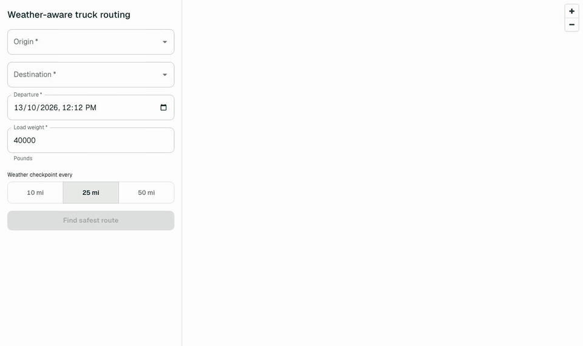
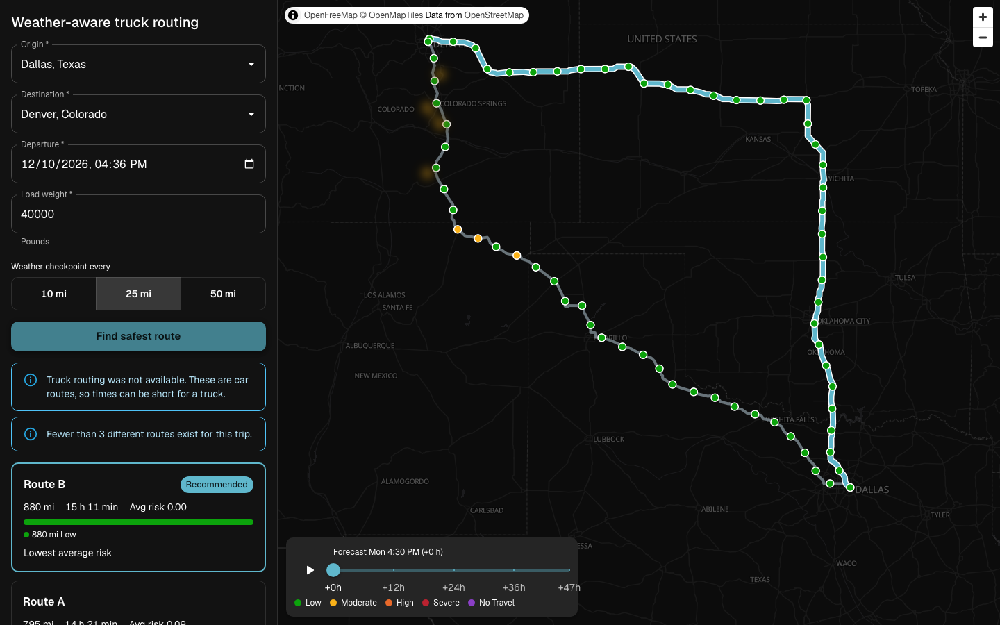
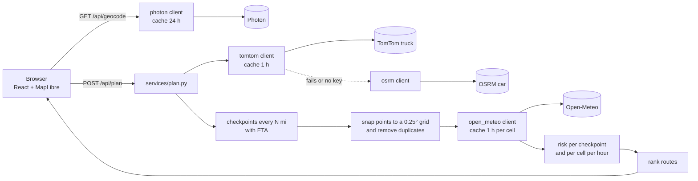

# Weather-Aware Truck Routing

Pick the safest truck route by checking the weather **at the time the truck reaches each point**, not the weather right now.

**Live app: https://truckroute.abhayymishraa.com** · [API health](https://api.truckroute.abhayymishraa.com/api/health) · React + TypeScript + MUI + MapLibre · Django + DRF



## Contents

- [What it does](#what-it-does)
- [Brief to code map](#brief-to-code-map)
- [Quick start](#quick-start)
- [How it works](#how-it-works)
- [Risk rules](#risk-rules)
- [Recommendation](#recommendation)
- [Performance](#performance)
- [Tests](#tests)
- [Decisions and trade-offs](#decisions-and-trade-offs)
- [Project structure](#project-structure)
- [Limits](#limits)
- [Deploy](#deploy)

## What it does

1. The driver enters origin, destination, departure time, and load weight.
2. The server gets **3 real truck routes** (TomTom truck mode, with the truck's gross weight) and places a checkpoint every **10, 25, or 50 miles**.
3. Each checkpoint gets the **forecast for its own ETA**, then a risk level from the brief's wind, rain, snow, and load rules.
4. The routes are ranked **safety first, travel time last**. Each card says why it won or lost.
5. A **0-48 h corridor heatmap** shows how the risk moves around the roads over time.

| Desktop | Mobile | Dark mode |
|---|---|---|
|  |  |  |

## Brief to code map

| The brief asks for | Where it lives | How to check |
|---|---|---|
| Origin, destination, departure, load | [`TripForm.tsx`](frontend/src/features/trip-form/components/TripForm.tsx), [`serializers.py`](backend/routing/serializers.py) | Departure must be within now - 15 min to now + 48 h; load 1 to 80,000 lb |
| 3 route options from a routing API | [`clients/tomtom.py`](backend/routing/clients/tomtom.py), fallback [`clients/osrm.py`](backend/routing/clients/osrm.py) | `test_routing_clients.py` |
| Weather every 10 / 25 / 50 mi at the truck's ETA | [`services/checkpoints.py`](backend/routing/services/checkpoints.py) `sample_checkpoints`, [`clients/open_meteo.py`](backend/routing/clients/open_meteo.py) | `test_checkpoints.py`; click any dot to see its ETA |
| Risk and load rules | [`services/risk.py`](backend/routing/services/risk.py) `checkpoint_level` | `test_risk.py` covers every boundary |
| Recommend the best route | [`services/risk.py`](backend/routing/services/risk.py) `rank_routes` | `test_ranking.py`; the reason line on each card |
| Routes, checkpoints, risk, ETAs, summaries on a map | [`features/map`](frontend/src/features/map), [`features/routes`](frontend/src/features/routes) | Click a card or a route line; click a checkpoint |
| Corridor heatmap with a 0-48 h slider | [`features/weather-heatmap`](frontend/src/features/weather-heatmap) | Drag the slider or press play |

## Quick start

**Use the live app:** https://truckroute.abhayymishraa.com

**Run with Docker** (the whole app on one machine, HTTPS through Caddy):

```bash
cp .env.example .env          # set DJANGO_SECRET_KEY, the domain, and TOMTOM_API_KEY
docker compose up --build -d
curl -sk https://localhost/api/health
```

**Run for development** (Python 3.14 with [uv](https://docs.astral.sh/uv/), Node 24):

```bash
cd backend && uv sync
TOMTOM_API_KEY=your-key uv run python manage.py runserver     # http://localhost:8000

cd frontend && npm ci && npm run dev                          # http://localhost:5173
```

The frontend proxies `/api` to port 8000. If that port is busy, start the backend on another port and run `API_PROXY=http://localhost:<port> npm run dev`.

The TomTom key is free at [developer.tomtom.com](https://developer.tomtom.com/) (no credit card). Without a key, the app still works with OSRM car routes and shows a notice. The key stays on the server and never reaches the browser.

## How it works

One `POST /api/plan` does all the work and returns one JSON answer.



| Data | Source | Notes |
|---|---|---|
| Routes and ETAs | TomTom Calculate Route | `travelMode=truck`, `vehicleCommercial=true`, `vehicleWeight` = load + 35,000 lb, `departAt`, `maxAlternatives=2`. Travel time at route points gives each checkpoint's ETA. |
| Fallback routes | OSRM | Car profile, with a "car routes" notice |
| Weather | Open-Meteo | Hourly sustained wind, gusts, rain + showers, snowfall, in mph and in/hr |
| Place search | Photon | US only |
| Map tiles | OpenFreeMap | MapLibre GL |

## Risk rules

| Condition | Low | Moderate | High | Severe | No Travel |
|---|---|---|---|---|---|
| Wind (mph) | < 25 | 25 to < 35 | 35 to < 45 | 45 to < 55 | ≥ 55 |
| Rain (in/hr) | < 0.10 | 0.10 to < 0.25 | 0.25 to < 0.50 | 0.50 to ≤ 1.00 | > 1.00 |
| Snow (in/hr) | < 0.5 | 0.5 to < 1.0 | 1.0 to < 2.0 | 2.0 to ≤ 3.0 | > 3.0 |

Load rules can only raise the level:

| Wind | Load | Result |
|---|---|---|
| ≥ 55 mph | any | No Travel |
| 45 to < 55 mph | > 30,000 lb | No Travel |
| 35 to < 45 mph | > 40,000 lb | Severe |

A checkpoint takes the worst of its wind, rain, and snow levels, and then the load rules apply.

The brief's ranges touch or leave gaps, so these edge choices are explicit and tested:
- Each lower bound is inclusive, so 34.5 mph is Moderate.
- A shared bound goes to the higher level, so 0.25 in/hr of rain is High. For safety, warning early is better than warning late.
- Wind uses the sustained speed. Gusts are shown but not scored.
- An ETA past the 48 h forecast, or a missing value, is **No Data**. It shows in gray and is not scored, so the app never guesses.

## Recommendation

Each checkpoint owns the miles halfway to its neighbors, so the miles always add up to the route length. Routes are compared key by key, and the first difference decides:

1. **Fewest No Travel miles.** A route with any No Travel miles always ranks below one with none. The brief does not rank No Travel, and a route the truck must not drive should never be recommended.
2. Fewest Severe miles.
3. Fewest High miles.
4. Lowest average risk, weighted by miles (Low 0 to No Travel 4).
5. Shortest travel time.

The top route gets the **Recommended** badge. Every card shows the key that decided its place, for example "Fewest Severe miles" or "More High miles". If every route has No Travel miles, a red banner says that no safe route exists in this time window.

## Performance

| What | Result |
|---|---|
| Requests per plan | **1** (routes, checkpoints, and heatmap together) |
| Weather cells, Dallas to Denver, 3 routes | **353**, sent to Open-Meteo in batches of 100 |
| Plan time, live API (Oracle free VM, 1 GB RAM) | **8.4 s** cold cache, **1.0 s** warm |
| Plan time, Docker on a laptop | **4.8 s** cold cache, **0.05 s** warm |
| Plan payload | **743 KB** of JSON, **203 KB** with gzip |
| Forecast slider | **0 React re-renders of the map.** It calls `setPaintProperty` for the heatmap color and opacity ([`ForecastSlider.tsx`](frontend/src/features/weather-heatmap/components/ForecastSlider.tsx)). All 48 hours are already in the response. |

How this is kept fast:
- **Grid snap.** Every checkpoint and corridor point snaps to a 0.25° cell (about 17 mi). Points in the same cell share one forecast, and the 3 routes share cells where they overlap.
- **Cell budget.** One plan uses at most 500 weather cells. Long trips drop the side corridor before they drop route cells, to stay under Open-Meteo's free limit of 600 per minute.
- **Caches.** Routes and each weather cell for 1 h, place search for 24 h, in Redis in production.
- **GPU map layers.** Routes, checkpoints, and heatmap cells are MapLibre layers. Selecting a route changes a layer filter, not React state on every feature.

Through Vercel, a warm plan took 1.1 to 4.1 s in tests, because Vercel's proxy may run far from the Mumbai VM.

## Tests

| Suite | Count | Command |
|---|---|---|
| Backend: risk, ranking, checkpoints, geometry, clients, plan, API | 100 cases | `cd backend && uv run pytest` |
| Frontend: form validation, cards, risk scale, heatmap, formatting | 15 | `cd frontend && npm test` |
| End to end: real browser, real APIs | 1 | `cd frontend && npm run e2e` |
| Lint and types | clean | `uv run ruff check .` · `npx oxlint` · `npx tsc -b` |

The risk and checkpoint code is pure: no network and no Django imports. That is why every boundary in the tables above has a direct unit test.

## Decisions and trade-offs

| Decision | Why | Cost |
|---|---|---|
| TomTom truck routing, OSRM fallback | Real truck rules and weight, plus travel time at points for accurate ETAs | Free tier: 20,000 requests a month. The fallback gives car routes with a clear notice. |
| One `/api/plan` request | No waterfall of requests in the browser; one cache key per trip | The first plan waits for all the data |
| 0.25° weather grid | Turns thousands of points into a few hundred forecasts | Weather smaller than about 17 mi can be missed |
| Shared bound goes to the higher level | Safety-first reading of ranges that touch | Slightly more warnings |
| No Travel ranks first | A No Travel route must never win on time | One rule added on top of the brief |
| Slider changes paint only | Smooth scrubbing on low-end phones | All 48 hours load up front (203 KB with gzip) |
| Business logic in pure `services/` | Easy to test and to read | A thin extra layer between views and clients |

## Project structure

```text
backend/
  config/settings/          base, local, production (all settings from env vars)
  routing/
    apis.py                 thin DRF views
    serializers.py          input validation
    services/               plan.py (orchestration), risk.py, checkpoints.py, geo.py: pure logic
    clients/                tomtom, osrm, open_meteo, photon: one module per outside API, cached
    tests/
frontend/src/
  app/                      App, AppShell (desktop side panel, mobile bottom sheet), providers
  features/
    trip-form/              form and place search
    routes/                 route cards, risk bar, recommendation reason
    map/                    MapLibre map, route and checkpoint layers, popup
    weather-heatmap/        corridor grid layer, 0-48 h slider, legend
  theme/                    MUI theme, color-blind-safe risk scale
docker-compose.yml          backend (gunicorn), redis, web (Caddy)
```

Features do not import each other. They are composed in `app/`.

## Limits

- The TomTom free tier allows 20,000 routing requests a month. OSRM car routes ignore truck rules.
- OSRM, Photon, Open-Meteo, and OpenFreeMap are public services with rate limits. If one returns 429, the app says the service is busy and to try again in 1 minute (HTTP 503).
- The forecast covers 48 h. Later checkpoints are No Data.
- The empty truck weight is fixed at 35,000 lb.
- The route is planned before the trip. Live re-planning from GPS during the trip is a possible next step.

## Deploy

| Part | Host | Address |
|---|---|---|
| Frontend | Vercel | `truckroute.abhayymishraa.com` |
| API | Oracle Cloud Always Free VM (E2.1.Micro, 1 GB RAM + 2 GB swap), Docker Compose | `api.truckroute.abhayymishraa.com` |

[`frontend/vercel.json`](frontend/vercel.json) rewrites `/api/*` to the API domain, so the browser stays on one origin and no CORS setup is needed. The Compose stack also serves the frontend build, so one VM alone can run the whole app.

<details>
<summary>Deploy steps</summary>

**API on an Ubuntu VM (Oracle Cloud):**

1. Allow TCP 80 and 443 in the VCN security list, and on the VM:
   ```bash
   sudo iptables -I INPUT 6 -m state --state NEW -p tcp --dport 80 -j ACCEPT
   sudo iptables -I INPUT 6 -m state --state NEW -p tcp --dport 443 -j ACCEPT
   sudo netfilter-persistent save
   ```
2. On a 1 GB VM, add swap before the build.
3. Install Docker, clone the repo, and create `.env` from `.env.example`. Set `SITE_ADDRESS` and `DJANGO_ALLOWED_HOSTS` to the API domain. With no domain, use `<public-ip>.sslip.io`.
4. Run `docker compose up --build -d`, then `curl -s https://<domain>/api/health`.

**Frontend on Vercel:** set the API domain in `frontend/vercel.json`, run `vercel deploy --prod` in `frontend/`, and point the domain's CNAME to `cname.vercel-dns.com`.

</details>
