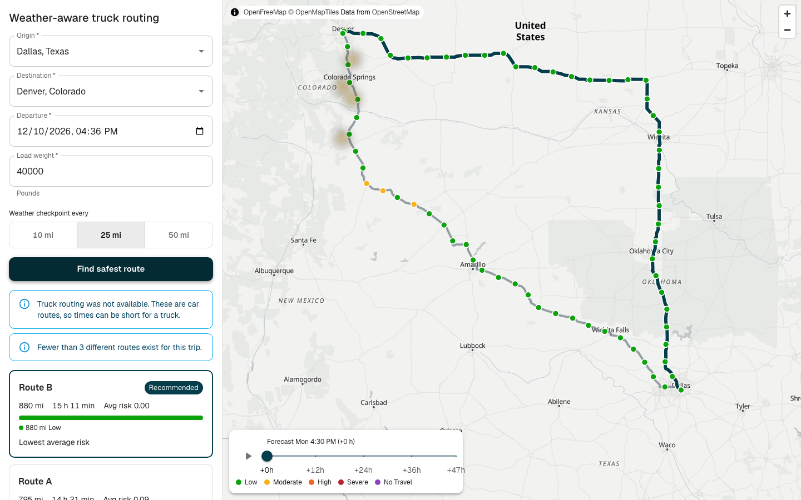
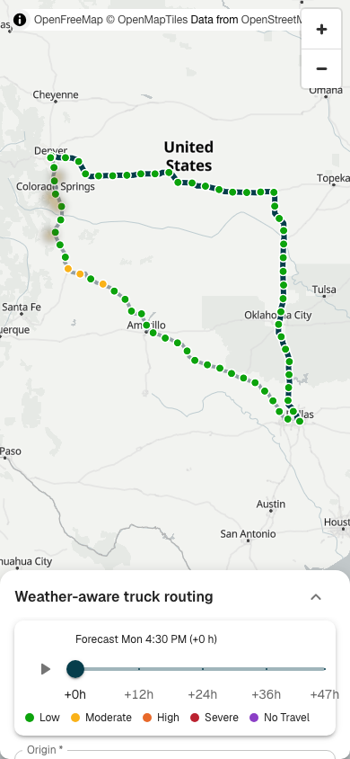

# Weather-Aware Truck Routing

Plan a truck trip, get up to 3 routes, and see the weather risk at the time the truck reaches each point. The app recommends the safest route and shows a 0–48 h corridor risk map.

Live demo: not deployed yet (see [Deploy](#deploy)).

| Desktop | Mobile |
|---|---|
|  |  |

## Run locally

Requirements: Python 3.14 with [uv](https://docs.astral.sh/uv/), Node 24.

```bash
# Backend (http://localhost:8000)
cd backend
uv sync
export TOMTOM_API_KEY=your-key   # optional, see "Routing" below
uv run python manage.py runserver

# Frontend (http://localhost:5173, proxies /api to the backend)
cd frontend
npm ci
npm run dev
```

If port 8000 is in use, run the backend on another port and start the frontend with `API_PROXY=http://localhost:<port> npm run dev`.

Tests:

```bash
cd backend && uv run pytest && uv run ruff check .
cd frontend && npm test && npx tsc -b && npm run e2e
```

`npm run e2e` starts its own backend (port 8001) and frontend (port 5174), and calls the live outside APIs.

Docker (production build, HTTPS through Caddy):

```bash
cp .env.example .env    # set DJANGO_SECRET_KEY, the domain, and TOMTOM_API_KEY
docker compose up --build -d
curl -sk https://localhost/api/health
```

## How it works

```
Browser (React)                    Django (DRF)                      Outside APIs
Address field ──GET /api/geocode──▶ photon client (cache 24 h) ─────▶ Photon
Trip form ─────POST /api/plan─────▶ services/plan.py
                                     1. tomtom client (cache 1 h) ───▶ TomTom (truck)
                                        fallback: osrm client ───────▶ OSRM (car)
                                     2. checkpoints every N mi + ETA
                                     3. corridor points along and beside each route
                                     4. snap all points to a 0.25° grid, dedupe
                                     5. open_meteo client (cache 1 h per cell) ▶ Open-Meteo
                                     6. risk level per checkpoint and per cell per hour
                                     7. rank the routes
◀──────────── one JSON response ────
```

- **Routing: TomTom Calculate Route** with `travelMode=truck`, `vehicleCommercial=true`, `vehicleWeight` (load + 35,000 lb empty truck), `departAt`, and `maxAlternatives=2`. The response gives the travel time at route points, so each checkpoint ETA comes from TomTom.
- **Fallback: OSRM** (car profile). The app uses it when TomTom has no key, fails, or hits its quota, and shows a "car routes" notice.
- **Weather: Open-Meteo** hourly `wind_speed_10m`, `wind_gusts_10m`, `rain + showers`, and `snowfall`, in mph and in/hr.
- **Geocoding: Photon**, limited to the US.
- **Map: MapLibre** with OpenFreeMap tiles.

Get a TomTom key: sign up at [developer.tomtom.com](https://developer.tomtom.com/) (no credit card), then set `TOMTOM_API_KEY` in the backend environment. The key stays on the server.

Code layout:
- `backend/routing/services/`: pure risk, checkpoint, and geometry logic, plus the plan orchestration.
- `backend/routing/clients/`: one module per outside API.
- `frontend/src/features/`: `trip-form`, `routes`, `map`, and `weather-heatmap`, composed in `src/app/`.

## Risk rules

| Condition | Low | Moderate | High | Severe | No Travel |
|---|---|---|---|---|---|
| Wind (mph) | < 25 | 25 to < 35 | 35 to < 45 | 45 to < 55 | ≥ 55 |
| Rain (in/hr) | < 0.10 | 0.10 to < 0.25 | 0.25 to < 0.50 | 0.50 to ≤ 1.00 | > 1.00 |
| Snow (in/hr) | < 0.5 | 0.5 to < 1.0 | 1.0 to < 2.0 | 2.0 to ≤ 3.0 | > 3.0 |

Edge choices, because the given ranges touch or leave gaps:
- Each lower bound is inclusive. For example, 34.5 mph is Moderate.
- A shared bound goes to the higher level. For example, 0.25 in/hr of rain is High.
- No Travel uses ≥ 55 for wind, and strictly greater than for rain and snow.
- Wind uses the sustained speed. Gusts are information only.

Load rules (they can only raise the level):
- Wind ≥ 55 mph: No Travel for any load.
- Wind 45 to < 55 mph and load > 30,000 lb: No Travel.
- Wind 35 to < 45 mph and load > 40,000 lb: Severe.

A checkpoint takes the highest of its wind, rain, and snow levels, then the load rules apply. A checkpoint with an ETA past the 48 h forecast, or with a missing value, is **No Data**. No Data is shown in gray and is not scored.

## Recommendation

Each checkpoint owns the miles from the midpoint with the previous checkpoint to the midpoint with the next one, so the miles add up to the route length.

Routes are ranked by:
1. Routes with no No Travel miles first, then fewest No Travel miles.
2. Fewest Severe miles.
3. Fewest High miles.
4. Lowest average risk, weighted by miles (Low 0 to No Travel 4; No Data excluded).
5. Shortest travel time.

The first route is recommended. Each card names the key that decided its place. If every route has No Travel miles, a red banner says that no safe route exists in this window.

## Performance

- **One request per plan.** `POST /api/plan` returns the routes, the checkpoints, and the heatmap together.
- **Grid snap and dedupe.** All checkpoints and corridor points snap to a 0.25° grid (about 17 mi). Dallas to Denver needs 291 weather cells for 2 routes, fetched in batches of 100.
- **Caches.** Routes are cached for 1 h, each weather cell for 1 h, and geocoding results for 24 h (Redis in production). Measured on Dallas to Denver: 4.8 s on a cold cache, 0.05 s on a warm cache.
- **Compression.** Caddy gzip reduces the plan response from 448 KB to 122 KB.
- **Slider.** The forecast slider changes the `fill-color` and `fill-opacity` paint properties of the corridor grid layer. The map does not re-render in React; only the slider label updates.

## Limits

- The TomTom free tier has 20,000 routing requests per month. When TomTom is not available, the app uses OSRM car routes, which ignore truck rules.
- OSRM, Photon, Open-Meteo, and OpenFreeMap are public services with rate limits.
- Open-Meteo's free tier allows 600 location calls per minute and 5,000 per hour. One plan uses at most 500 weather cells: long trips drop the side corridor and keep the cells along each route.
- The forecast covers 48 h. Later checkpoints are No Data.
- The weather grid is about 17 mi, so very local weather can be missed.
- The empty truck weight (35,000 lb) is a fixed value.

## Deploy

The app runs on one VM with Docker Compose: `backend` (gunicorn), `redis`, and `web` (Caddy serves the frontend build, proxies `/api`, and gets the HTTPS certificate).

On an Oracle Cloud VM (Ubuntu):
1. Add ingress rules for TCP 80 and 443 to the VCN security list.
2. Open the same ports on the VM:
   ```bash
   sudo iptables -I INPUT 6 -m state --state NEW -p tcp --dport 80 -j ACCEPT
   sudo iptables -I INPUT 6 -m state --state NEW -p tcp --dport 443 -j ACCEPT
   sudo netfilter-persistent save
   ```
3. Install Docker, clone the repo, and create `.env` from `.env.example`. With no domain, use `<public-ip>.sslip.io` for `SITE_ADDRESS` and `DJANGO_ALLOWED_HOSTS`.
4. Run `docker compose up --build -d`, then check `curl -s https://<domain>/api/health`.
